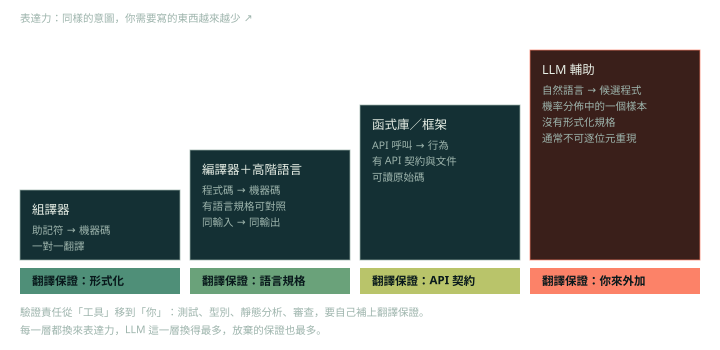

程式設計的歷史常被說成一條「抽象」的階梯，AI 輔助程式設計是最新的一階。這個敘事沒有錯，但它隱藏了一個對工程決策最重要的區分：**每一層換來了什麼，又放棄了什麼**。

標示方式：**【判斷】** 是工程判斷，可以反駁；未標示的內容是業界常見的說法或公認的事實。

## 常見的敘事：一路往上的抽象

程式語言與工具的演進，就是把繁瑣細節藏到背景，讓開發者專注在重要的事：

- 1940 年代：從機器碼到組合語言。
- 1950 年代：Fortran、COBOL 等高階語言，由編譯器翻成機器碼。
- 1970 年代：C、Pascal 等程序式語言，用函式組織程式。
- 1980 年代：C++、Java 等物件導向語言。
- 1990 年代：Python、Ruby、JavaScript 等腳本語言。
- 2010 年代：TensorFlow、PyTorch 等機器學習框架。
- 2020 年代：以 LLM 為基礎的 AI 輔助程式設計。

一句流行的說法是「**英文是最熱門的新程式語言**」：用自然語言描述，就能得到程式碼。也常聽到開發者說 AI 已經寫了大部分的程式碼，自己現在是「提示加編輯」而不是手寫。

## 把「抽象」拆成三個可檢驗的性質【判斷】

1. **表達力**：同樣的意圖，你要寫多少。
2. **翻譯保證**：上層寫的東西，如何變成下層的行為？誰保證語意一致？
3. **可重現**：同樣的輸入，是否得到同樣的輸出？

| 層 | 你寫的 | 翻譯保證 | 可重現 | 出錯時怎麼查 |
|---|---|---|---|---|
| 組譯器 | 助記符 | 一對一對應 | 是 | 看反組譯 |
| 編譯器與高階語言 | 程式碼 | 語言規格；編譯器也有 bug，但屬於可回報、可修的系統性錯誤 | 是（同編譯器、同旗標） | 看編譯器輸出、縮成最小重現 |
| 函式庫與框架 | API 呼叫 | API 契約與文件 | 是 | 讀文件、讀原始碼 |
| LLM 輔助 | 自然語言加上既有程式碼 | 沒有形式化規格；輸出是機率分佈中的一個樣本 | 多數供應商不保證，連 temperature 設為 0 也一樣 | 只能靠你外加的檢查 |

## 為什麼「英文是新的程式語言」會誤導【判斷】

編譯器是「形式語言到形式語言」的函數，有規格可以對照，所以你敢把它當成可信的基礎設施。LLM 做的是「含糊的自然語言，到一個很可能合理的程式」。**你的 prompt 不是規格**，因為沒有任何東西能判定輸出是否符合它。

這件事的工程後果有三個：

1. **規格必須是可執行的**：測試、型別、契約、範例。prompt 只是產生候選解的手段，測試才是驗收標準。
2. **工作內容從寫轉成讀**：「提示加編輯」的成本主要在編輯：讀懂、判斷、驗證。審查能力成為瓶頸。就算 AI 產生的程式碼有八成是對的，也代表大約每五段就有一段需要人修正。
3. **槓桿在讓驗證變便宜，不在讓生成變快**：快速可靠的測試、型別、lint、可重現的環境，是對所有 AI 輔助任務都生效的投資。

## GenAI 的版圖

- 人工智慧（AI）包含機器學習（ML），ML 包含深度學習（DL），DL 包含生成式 AI（GenAI），GenAI 的核心是大型語言模型（LLM）。
- AI 是能完成需要人類智慧的任務的系統；ML 從資料中歸納而不是硬寫規則；DL 是 ML 中使用多層神經網路的子集；GenAI 產生反映其訓練資料的新資料；GPT、Gemini、Claude、LLaMA 這類大型模型常被稱為 foundation model。
- GenAI 不只文字，也有多模態（multimodal）能力：圖像、音訊、影片。

**【判斷】** 補兩個容易誤讀的地方：

- 巢狀圖表示「類別包含」，不是時間先後，也不是能力高低。LLM 是 DL 裡的一種 GenAI 模型，不是「比機器學習更高級的東西」。
- **foundation model 不等於你用的產品。** Copilot 或 ChatGPT 是模型、context 蒐集、前後處理與介面的總和（見〈AI 開發工具地圖與導入考量〉）。比較兩個工具時，差別常在模型以外的部分。

## 常見說法與校正

- 常見的敘事把 2010 年代的機器學習框架與 AI 輔助程式設計放在同一條抽象階梯上。框架確實隱藏了數學細節。**【判斷】** 但「函數是從資料學出來的」和「函數是人寫的」是不同典範：你沒辦法逐行 review 一個權重矩陣，也沒辦法 diff 出「這次模型改了什麼行為」。這正是為什麼 LLM 輔助不能直接套用「更高階語言」的信任模型。
- 把 AI 輔助程式設計視為下一層抽象是合理的敘事，但它同時是**最不確定的一層**：換來最大的表達力，放棄了最多的保證。
- 「AI 寫了 80% 的程式碼」這類說法是個人感受。拿來當生產力證據時，要明確標示它的證據等級（見 Week 8〈判讀生產力證據：數字背後的研究設計〉）。

## 檢查點

Q: 「英文是最新的程式語言」這個比喻，在工程決策上最大的問題是什麼？
- [ ] 英文太冗長，寫 prompt 比寫程式碼慢
- [ ] LLM 無法產生需要編譯的語言
- [x] 編譯器對形式語言有規格與可重現的翻譯；LLM 的輸出沒有形式化保證，所以必須由可執行的檢查（測試、型別、審查）來承擔「翻譯保證」
- [ ] LLM 產生的程式碼一律是錯的
解釋: 比喻的問題不在表達力，而在保證。你信任編譯器，是因為翻譯有規格可對照、結果可重現；LLM 沒有這兩項，所以信任必須來自外加的驗證。說「一律是錯的」或「不能產生編譯語言」都是事實錯誤，說「太冗長」則是風格問題，不是決策問題。

## 思考練習

Q: 你的團隊正在導入 AI 助手。請說明為什麼「生成速度」不是主要瓶頸，並提出三項能讓「驗證」變便宜的投資。
- 瓶頸從寫轉到讀與判斷：審查時間、返工成本、缺陷逃逸率，才是端到端的指標。
- 快速且可靠的測試套件，加上分鐘級的 CI 回饋：讓每個候選解都能被機器快速判定。
- 型別、lint、靜態分析與可重現的開發環境：把一整類錯誤變成編譯期錯誤。
- 規則檔、範例與契約（OpenAPI、schema）：縮小 prompt 的歧義，讓「對」有可檢查的定義。
- 小而聚焦的 PR 與清楚的 PR 描述：降低每次審查的成本。
